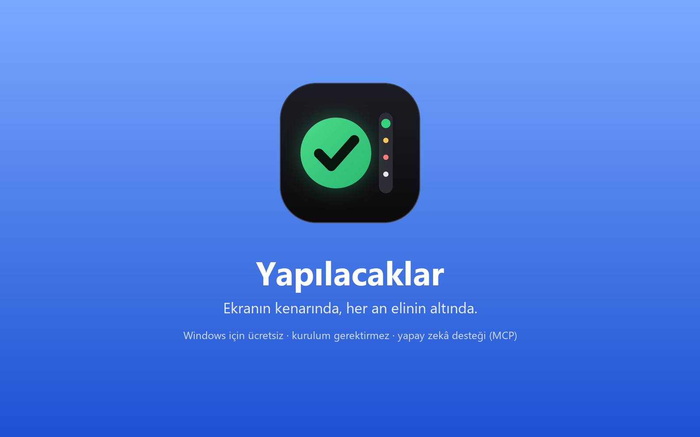
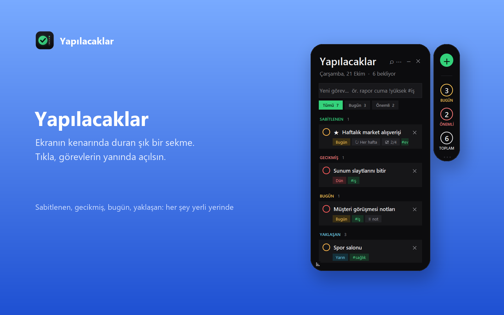
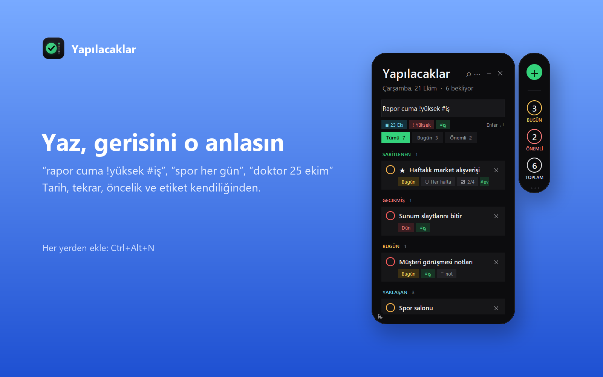
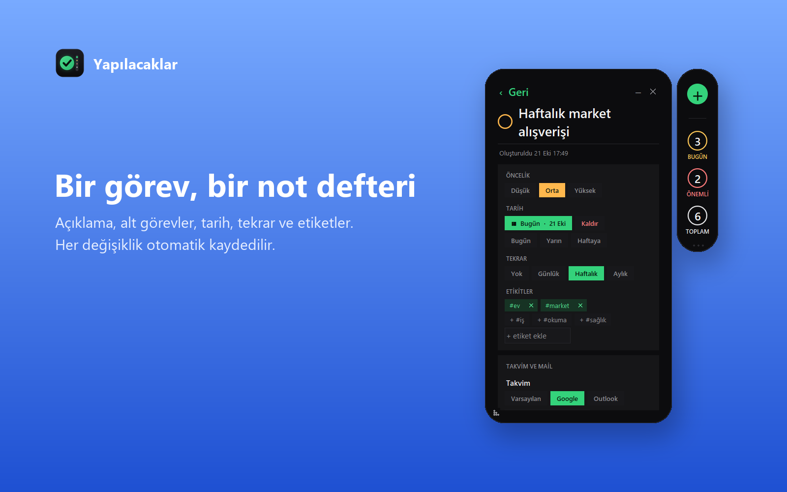
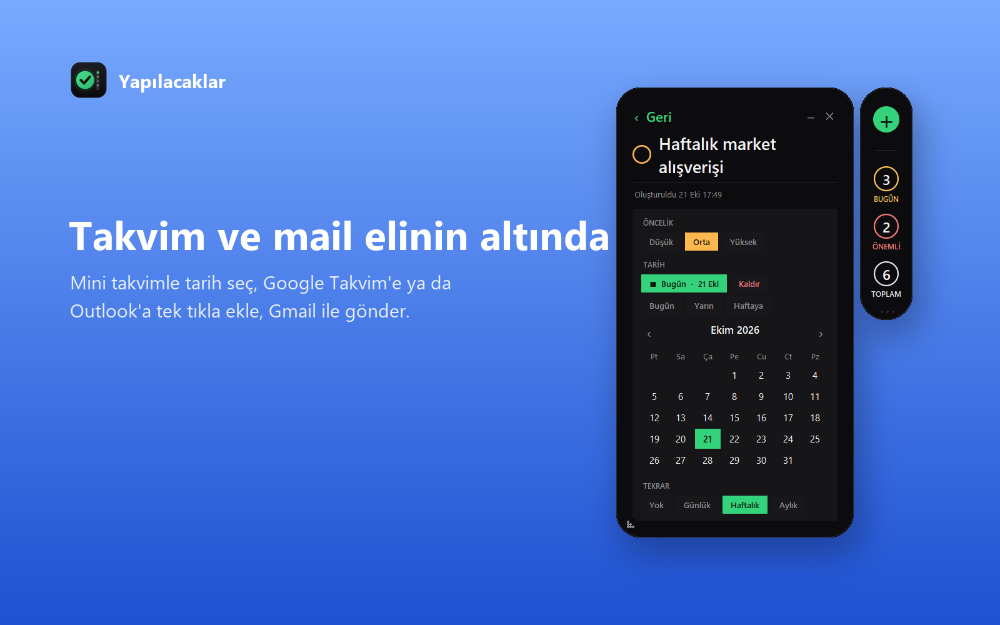
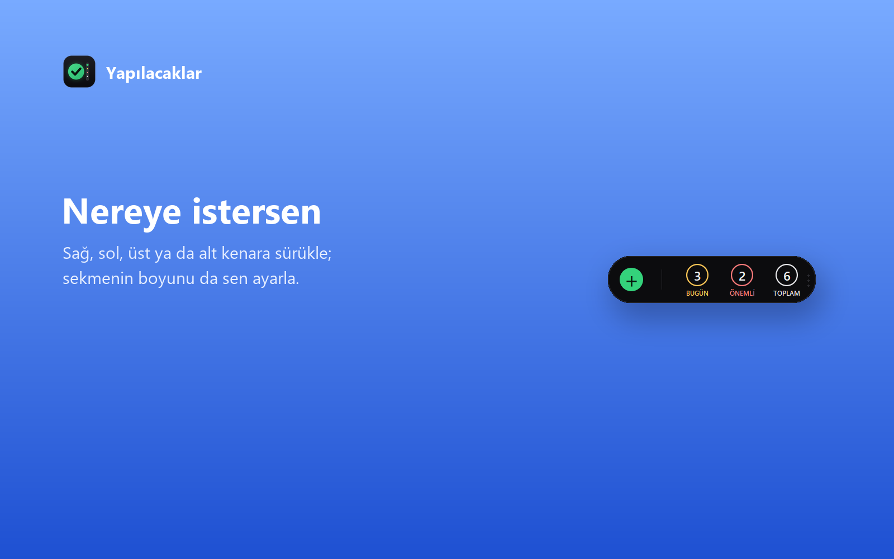
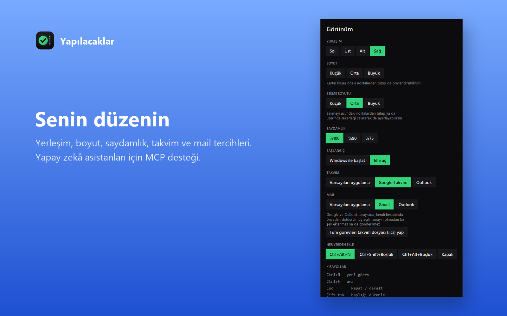

# Kenar: Yapılacaklar

Ekranının kenarında duran, tıklayınca yanında açılan modern bir yapılacaklar listesi (Windows). Türkçe doğal dille hızlı ekleme, alt görevler, mini takvim, tekrar, takvim/mail aktarımı ve yapay zekâ asistanları için MCP sunucusu. Tamamen yerel: hesap, reklam, takip yok.

*A sleek to-do list docked to the edge of your Windows screen. Click the tab and the list opens beside it. Natural-language quick add (Turkish), subtasks, mini calendar, repeats, calendar/mail export and an MCP server for AI assistants. Fully local: no account, no ads, no tracking.*

[](https://www.microsoft.com/store/productId/9PCJR13N9HFM?ocid=libraryshare)

**Microsoft Store:** https://www.microsoft.com/store/productId/9PCJR13N9HFM?ocid=libraryshare



## Ekran görüntüleri / Screenshots

| | |
|---|---|
|  |  |
| Görev listesi | Hızlı ekleme ve canlı önizleme |
|  |  |
| Görev detayı, alt görevler | Mini takvim |
|  |  |
| Üstte/altta yatay yerleşim | Ayarlar |

## Gizlilik
Görevler yalnızca kendi bilgisayarında saklanır. Ayrıntı: [PRIVACY.md](packaging/store/PRIVACY.md).

## Lisans
[MIT](LICENSE)

---

# Developer notes

## Widget
Double-click `todo.bat` or run `python -m todo`.
- Always on top and borderless; drag the header to place it anywhere. `-` collapses it to a small bubble, click the bubble to open it again.
- Quick add in plain Turkish, then Enter: `rapor cuma !yuksek #is`, `spor her gun`, `doktor 25 ekim`, `fatura 5.11` (a live preview shows what was understood). Older form: `Buy milk !high #home @tomorrow` (priority `!high/!medium/!low` or `!h/!m/!l`, tags `#tag`, due `@today`, `@tomorrow`, `@yarin`/`@bugun` or `@YYYY-MM-DD`).
- Click a task to open its detail page (autosaves): title, description, subtasks with progress, priority, due date (mini calendar), repeat (daily/weekly/monthly, rolls the due date forward when completed), tags (add/remove, suggestions), pin to top, copy, duplicate, delete.
- Older note: description (note), title, priority, due date (Today/Tomorrow/Next week/typed), tags. Double-click the title to edit it. Save with Enter or the Save button.
- Smart lists: Tumu / Bugun / Onemli tabs; clicking a counter on the pill opens that list. Ctrl+Alt+N (changeable in the menu) adds a task from any program. Completing a task shows an Undo toast.
- Search with the magnifier (Ctrl+F), Ctrl+N focuses the quick-add field. Deleting shows an Undo toast for 5 seconds; completed tasks can be cleared in one click.
- Click the circle to complete (click again to reopen), the cross to delete. The widget refreshes when the data file changes (e.g. after an AI edit).
- Data: `~/.todo-app/tasks.json` (override with env `TODO_APP_DATA`).

## Calendar and mail
- Detail page: **Takvime ekle** writes the task (all-day event on its due date, with repeat rule, tags, note and subtasks) to a `.ics` file and opens it in your default calendar app. **Mail ile gonder** opens your default mail app with the task as subject and body.
- Menu: **Tum gorevleri takvim dosyasi (.ics) yap** saves every pending task that has a due date; import it into Google Calendar, Outlook or Windows Calendar.
- Mail to task: connect an AI assistant that has a Gmail/Outlook connector to the MCP server below and ask it to turn a mail into a task (`add_task` / `update_task`).

Choose the providers in the menu (**TAKVIM** and **MAIL**): default app, or Google (Calendar / Gmail) and Outlook on the web. Google and Outlook open a prefilled new-event / compose page in your browser, signed in as you; nothing is added or sent without your confirmation there. No API keys or sign-in inside this app.

## MCP server (stdio)
Tools: `list_tasks`, `add_task`, `update_task` (title, note, priority, due, tags), `complete_task`, `delete_task`.

Claude Code:
```
claude mcp add todo -- python -m todo.mcp_server
```
(run it with this folder as the working directory, or set `cwd`/`PYTHONPATH` to it.) Claude Desktop / other clients: command `python`, args `["-m", "todo.mcp_server"]`, working directory = this folder.

## Windows executable (for people without Python)
```
python -m pip install pyinstaller pillow
python packaging/build.py
```
This writes `dist/Todo.exe` (the widget; only one copy runs at a time) and `dist/Todo-MCP.exe` (the stdio MCP server, e.g. `claude mcp add todo -- C:\path\Todo-MCP.exe`). Each user's tasks live in their own `~/.todo-app/`. The exe is not code-signed, so Windows SmartScreen may warn on first launch ("More info" -> "Run anyway").

## Tests
`python -m unittest discover -s tests`
